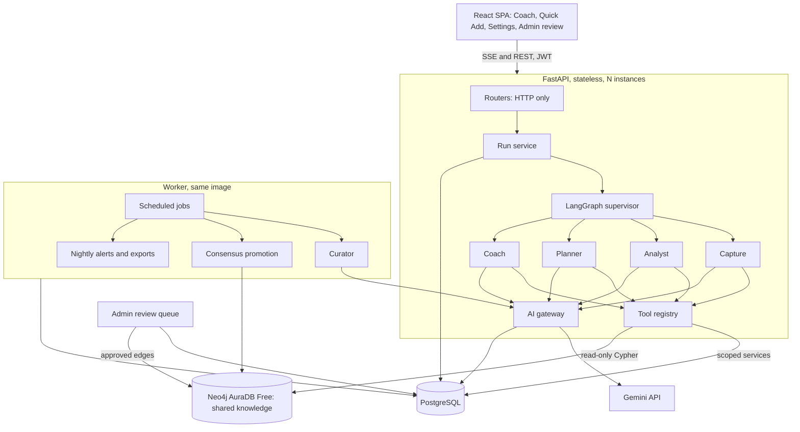

# BuFin: agent harness design (HLD and LLD)

Implements the decisions in `DECISIONS.md` (ADR-1 to ADR-10). Facts about today's code were read from `main`: `backend/ai_service.py` (603 lines, Ollama plus Gemini, old `google.generativeai` SDK), `backend/routers/ai.py` (five endpoints taking raw `dict` bodies, with transactions sent by the client), `GEMINI_API_KEY` as the only key source, no settings page (`ProfilePage.jsx` is the nearest), and no tests.

## 1. Goals and non-goals

Goals: Gemini-only AI behind one gateway; user-configurable model and key; specialist agents with typed tools; a shared knowledge graph that improves with consented usage; a stateless, horizontally scalable API; zero recurring cost.
Non-goals for now: a paid tier (only the hooks for it), a chosen hosting provider, bank or UPI data ingestion, Redis.

## 2. High-level architecture



Postgres is the system of record for user data, agent state (LangGraph checkpoints), run tables, quotas, the queue and the review queue. Neo4j holds no user data.

## 3. The AI gateway (single entry for every model call)

Module `backend/ai/gateway.py`. Nothing else imports `langchain_google_genai`.

Responsibilities, in call order:
1. Resolve the key: user key (decrypt), else server key, else raise `AIDisabled`. Record which one was used.
2. Check the quota for that key source. User-key calls skip the server quota. Server-key calls use a per-user daily budget in Postgres and an overall guard for Gemini's per-minute limit.
3. Redact identifiers from the prompt and tool results (`redaction.py`).
4. Look up the response cache (key: model, prompt version, hash of the redacted prompt). Only for deterministic, non-personal prompts such as classification.
5. Call the model through a circuit breaker (state in Postgres), with retries and backoff. Quota or rate errors map to a typed `AIQuotaExceeded` that the API turns into HTTP 429 and a clear Settings hint.
6. Record the call in `agent_steps` (provider, model, prompt version, tokens, latency, key source, fallback) and emit an OpenTelemetry span.
7. Return structured output (Pydantic schema via LangChain structured output), never regex-extracted JSON.

The key is injected only at step 5 and is excluded from graph state, checkpoints, logs and spans.

## 4. Agents

State: a LangGraph `TypedDict` holding messages, the resolved scope (user id, household id), the chosen agent, pending confirmation and a run id. It never holds keys or raw secrets.

| Agent | Purpose | Tools | Writes |
|---|---|---|---|
| Supervisor | classify intent, route, summarise | none | no |
| Capture | parse "Salary 53200 last working day" into actions | `resolve_merchant` (graph + SQL overrides), `check_amount_plausible`, `propose_transaction`, `propose_recurring`, `propose_debt`, `propose_plan_update` | proposals only, then the write gate |
| Analyst | answer ledger questions with source rows | `spend_by_category`, `spend_trend`, `list_upcoming`, `balance_summary`, `search_transactions` | no |
| Planner | what-if, goal timing, safe-to-spend | `safe_to_spend`, `simulate_purchase`, `goal_projection`, `forecast` (all deterministic) | no |
| Coach | advice, education, grounded search | `kg_lookup` (instruments, tax sections), `web_search` (Gemini grounding), plus Analyst's read tools | no |
| Curator (worker) | propose graph edges for unknown merchants and gaps | `unknown_merchants` (aggregated, normalized), `propose_edge` | review queue only |

Rules that hold for every tool:
- Arguments are Pydantic models; free text from the user or from data is never interpolated into a tool's query. Merchant names are data, not instructions (prompt-injection containment).
- Tools call services that already enforce user and household scope. They never accept a `user_id` argument; the scope comes from the run context.
- Tool results are shaped to the fields needed, then redacted by the gateway.
- Money maths is deterministic code. The model explains numbers; it never computes them.

### 4.1 Write gate

A proposal tool returns a typed action card and calls `interrupt()`. The SSE stream emits an `interrupt` event containing the card. The UI shows the confirmation. `POST /api/agent/runs/{id}/resume` with `{approve: true|false, edits?}` continues the run, which then calls the real write service. Only the write service touches money tables. A run waiting for confirmation expires after a configurable time and is marked `abandoned`.

## 5. Knowledge graph

Neo4j AuraDB Free, accessed only through `backend/kg/repository.py`, which exposes named read queries and a single write path used by the promotion job. No agent can run arbitrary Cypher.

Schema (no user identifiers anywhere):

```
(:Alias {text})            -[:RESOLVES_TO {confidence, source, updated_at}]-> (:Merchant {name})
(:Merchant)                -[:IN_CATEGORY {confidence, source, updated_at}]-> (:Category {name})
(:Category)                -[:CHILD_OF]-> (:Category)
(:Instrument {name,kind})  -[:GOVERNED_BY]-> (:TaxSection {code,limit})
(:BillType {name})         -[:TYPICALLY_IN]-> (:Category)
```

`source` is `seed`, `consensus` or `llm`. Reads prefer higher confidence and `seed` or approved `consensus`. Per-user overrides live in the SQL table `merchant_overrides` and win over the graph for that user.

Resilience: reads use a short timeout. If Aura is paused or unreachable, `resolve_merchant` falls back to SQL overrides and the model's own judgment, and the run records `kg_unavailable`. A nightly job exports the graph to a versioned file because the free tier has no backups.

### 5.1 Learning and promotion

1. A user correction is stored in `merchant_overrides` (SQL) and, if the user opted in, a row in `correction_events` with only the normalized merchant string and category.
2. The nightly promotion job groups `correction_events` by pair and counts distinct opted-in users. At three or more it writes a `graph_proposals` row with evidence counts.
3. The Curator agent can add `graph_proposals` for unknown merchants with `source=llm`.
4. An admin with permission `kg.review` approves, edits or rejects each proposal in the Knowledge review page. Approval writes the edge with `source=consensus` or `llm` and records an audit row.

## 6. Data model additions (Postgres)

| Table | Key columns |
|---|---|
| `user_ai_settings` | user_id, model, encrypted_api_key, key_last4, key_validated_at, features (JSON of per-feature toggles), kg_opt_in |
| `agent_runs` | id, user_id, household_id, agent, status (running, awaiting, done, failed, abandoned), key_source, started_at, finished_at |
| `agent_steps` | run_id, seq, kind (model, tool, interrupt), name, prompt_version, tokens_in, tokens_out, latency_ms, fallback, error |
| `ai_usage` | user_id, day, key_source, calls, tokens (quota counter) |
| `ai_cache` | key, value, expires_at |
| `breaker_state` | name, state, opened_until |
| `merchant_overrides` | user_id, normalized_merchant, category |
| `correction_events` | normalized_merchant, category, user_hash_for_distinct_count, created_at |
| `graph_proposals` | id, kind, payload, source, evidence_count, status, reviewed_by, reviewed_at |
| `roles`, `permissions`, `role_permissions`, `user_roles` | permission names such as `kg.review` |
| `audit_log` | actor, action, target, at |
| LangGraph checkpoint tables | created by `PostgresSaver` |

`correction_events` never stores a user id; `user_hash_for_distinct_count` is a salted hash used only to count distinct users and is dropped once a pair is promoted or expires.

## 7. API surface

| Endpoint | Purpose |
|---|---|
| `GET/PUT /api/settings/ai` | read masked settings, set model, key and toggles; `PUT` validates the key with a test call |
| `DELETE /api/settings/ai/key` | remove the stored key |
| `POST /api/agent/runs` | start a run with `{agent_hint?, message, context_ref}`; returns an SSE stream |
| `POST /api/agent/runs/{id}/resume` | approve, reject or edit a pending write |
| `GET /api/agent/runs/{id}` | status and steps for the UI |
| `GET /api/ai/usage` | the user's own usage and remaining server-key budget |
| `GET/POST /api/admin/kg/proposals` | list, approve, edit, reject (permission `kg.review`) |
| `GET /api/health` | liveness and dependency checks for the container |

The existing five `/api/ai/*` endpoints are replaced by agent calls. They stop taking transaction lists from the client; the tools read the data on the server under the caller's scope.

## 8. Frontend changes

- A Settings page: model picker, key field (masked, with test and remove), per-feature AI toggles, graph opt-in, usage meter, free-tier data notice.
- Coach and Quick Add use one SSE client and render tool steps, streamed text and confirmation cards.
- An admin-only Knowledge review page behind permission `kg.review`.
- The AI-disabled and quota-reached states are designed states, not errors.

## 9. Scaling model

- API instances are stateless; run state and checkpoints are in Postgres, so any instance can resume a run. No sticky sessions.
- The worker runs the same image with a different command, and scales by adding processes consuming the Postgres queue.
- Postgres is the first bottleneck. Mitigations in order: indexes (P1.2), connection pooling (PgBouncer), read replicas, then moving quotas, rate limits, cache and the queue to Valkey or Redis behind the existing interfaces (`Queue`, `RateLimiter`, `Cache`, `Breaker`).
- Gemini limits are the practical ceiling for server-key users; user keys spread that load.
- Neo4j holds small shared data, so its limits matter only if the taxonomy grows past the free cap.

## 10. Testing and evaluation

- Unit: redaction, key resolution order, quota maths, the write gate, scope filtering in every tool.
- Contract: each tool's Pydantic schema; a test that no tool accepts a user id.
- Graph: repository queries against a disposable Neo4j in Docker.
- Eval: the golden set run with a fake model in CI and with Gemini nightly or on demand. Seed cases: the 53200 to 53000 amount bug, "last working day", "Change Netflix to 649", injection strings in merchant names.
- Security: a test that the API never returns a stored key and that keys never appear in captured logs or `agent_steps`.

## 11. Delivery order

1. Foundations: JWT secret from environment, test net, CI, Dockerfiles and Compose.
2. Postgres: migrate, fix the baseline migration, indexes and constraints; money as integers and real date types can ride along.
3. Gateway: new SDK, Ollama removed, key resolution, Fernet storage, Settings page, redaction, quotas, run tables.
4. Harness: supervisor, tool registry, write gate, SSE API, Capture migrated, golden eval set.
5. Specialists: Analyst (needs server-side aggregates), Planner, Coach.
6. Graph: seed and read tools, then Curator, consensus job, admin review page.
7. Scale and ops: worker schedules, dashboards, load tests.

This order replaces the sequence at the end of `SCALING-ROADMAP.md`: Postgres now precedes the AI gateway.

## 12. Open items to settle during implementation

- The exact job-queue library (Procrastinate or PGQueuer) and the SSE client library.
- The initial seed content for merchants, categories, instruments and tax sections, and who curates it.
- Default per-user daily budget for server-key calls, set from Gemini's current free limits.
- The retention period for `agent_steps` and `correction_events`.
