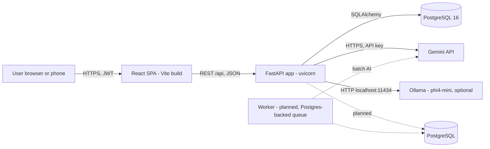
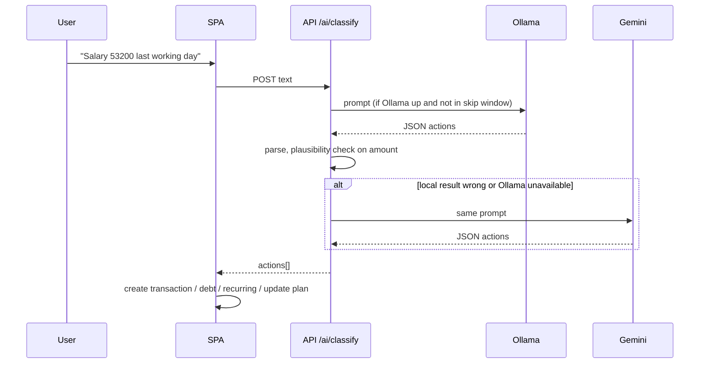
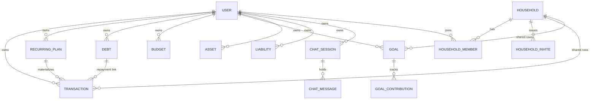
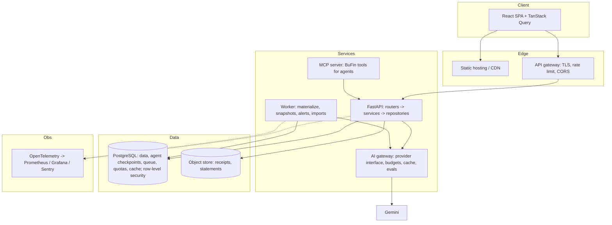

# BuFin: High-Level Design

Status: describes the system as it is on `main` (November 2026) and the target it should grow into. Every claim in "Current state" was read from the code, not assumed.

## 1. Purpose and scale

BuFin is a personal and household finance manager for Indian users (INR). One person or a small household logs transactions, plans recurring commitments, tracks budgets, goals and net worth, and gets an AI-assisted view of "how much can I safely spend today".

Today it is a single-process, single-database app used by a handful of people. The goal of this document is to show where it breaks first as users, data and AI usage grow, and what to change in what order.

## 2. System context

Solid lines exist today. Dashed lines are the target.

## 3. Containers and components (current)

| Container | Tech | Responsibility |
|---|---|---|
| SPA | React 19, Vite 7, Tailwind 4, Recharts, react-router 7 | All presentation. Holds most financial computation (balance, safe-to-spend) in the browser. |
| API | FastAPI, SQLAlchemy 2, Pydantic 2, python-jose, passlib/bcrypt | CRUD for 10 resources, auth, AI orchestration. 57 endpoints across 10 routers. |
| Database | SQLite, Alembic migrations | One file. 16 tables. |
| AI | Gemini 2.5/3 Flash (cloud), phi4-mini via Ollama (local, optional) | Quick Add parsing, spending alert, tips, purchase analysis, coach chat. |

Backend modules (`backend/`): `main.py` (wiring, CORS), `database.py`, `models.py`, `schemas.py`, `auth_utils.py`, `ai_service.py`, `routers/{auth,transactions,recurring,debts,budgets,goals,households,net_worth,chat,ai}.py`.

Frontend (`src/`): `context/` (Auth, Financial, Theme, Toast), `lib/api.js` (all HTTP), `hooks/` (safe-to-spend, spending alert), `pages/` (13), `components/` (about 38, plus `ui/` primitives).

## 4. Key flows

### 4.1 Authentication
Email and password sign-up. Passwords hashed with bcrypt. Login returns a 24-hour HS256 JWT whose `sub` is the email. The SPA stores it in `localStorage` and sends `Authorization: Bearer`. Every router depends on `get_current_user`.

### 4.2 Household scoping
A user can act as "Personal" or as a household they belong to. The SPA sends `X-Household-Id`; `get_active_household_id` verifies membership (403 otherwise). Transactions and goals filter by one scope or the other, never a mix (`_scope_filter`).

### 4.3 AI Quick Add

### 4.4 Recurring plans
A plan is a template. There is no scheduler. On every `GET /recurring_plans` the API lazily creates a real `Transaction` for each due monthly occurrence (tagged with `recurring_plan_id`), anchored at the last materialized occurrence.

### 4.5 Net worth
Assets and liabilities are user-entered. A snapshot row is written on each mutation (event-triggered, again because there is no scheduler).

## 5. Data architecture

16 tables, string UUID primary keys, `user_id` foreign key on every owned row, nullable `household_id` on transactions and goals. See `LLD.md` for columns.

## 6. Cross-cutting concerns (current state)

| Concern | State |
|---|---|
| Authn/z | Works. Per-user filtering on every router; household membership checked. The JWT secret now comes from `JWT_SECRET_KEY` (required, 32+ characters, when `BUFIN_ENV=production`; PR #149). All AI routes require login since PR #167. Still open: no refresh tokens or revocation (a token lives 24 hours, even after a password change or account deletion), no password policy, no rate limit on sign-in (#155). |
| Config | Mostly env (`GEMINI_API_KEY`, `JWT_SECRET_KEY`, `BUFIN_ENV`, `OLLAMA_*`). Hard-coded: DB URL, CORS origins; the frontend API URL became configurable in PR #106. |
| Money | Stored as `Float`. Dates stored as ISO `String`. |
| Concurrency | The CRUD handlers are plain `def`, so FastAPI runs them in a threadpool. What can block the event loop is the `async def` code: the dependency `get_current_user` runs a synchronous DB query on the loop for every authenticated request, and the AI handlers in `routers/ai.py` call synchronous Gemini/Ollama clients (the coach call was moved to a thread in PR #171; the SDK-based calls were not). |
| Observability | `print` statements. No metrics, tracing or error reporting. |
| Testing | A pytest suite exists for the backend (auth secret, AI routes, transaction listing, account lifecycle, atomic money operations, date maths; in-memory databases only). No frontend tests, and CI does not run pytest yet (milestone #142). |
| CI/CD | GitHub Actions runs the frontend build, lint of changed files, a backend import check and the Alembic single-head check. It does not run tests. No Dockerfile on `main` (PR #83 pending). |
| Rate limiting | None, including on the AI endpoints that cost money. |
| Privacy | Prompts containing transaction data go to Gemini unless Ollama answers. Privacy Mode masks the UI only. |

## 7. Quality attributes and the first thing that breaks

1. **Correctness of money.** Float arithmetic and string dates will produce off-by-paisa and off-by-a-day bugs (two have already shipped: #69 and the "upcoming" bug). Highest risk because it is silent.
2. **Security of a deployed instance.** The JWT secret is public in the repository. Anyone can mint a token for any email.
3. **Event-loop blocking.** A slow Gemini call (up to tens of seconds) stalls every other request on that worker.
4. **Client-side aggregation.** The SPA downloads the whole ledger (in pages of 500 since PR #170; before that it silently got only 100 rows) and computes balance, safe-to-spend, forecasts and trends itself. Fine for hundreds of rows, wrong for tens of thousands, and it makes every client re-implement money rules.
5. **SQLite single writer.** Fine for one user. Blocks multi-user write concurrency and any second server instance.
6. **AI cost and abuse.** No quotas, caching, or budgets per user.

## 8. Target architecture

Principles for the target:
- Server owns money rules. The SPA renders; it does not compute balances.
- One AI gateway for every model call: provider interface, per-user budget, cache, retries with a circuit breaker (generalizing the Ollama skip window), prompt versions, and an evaluation set.
- Anything time-based runs in a worker, not on page load.
- Tenant isolation enforced in the database (row-level security), not only in router filters.
- Every change ships through CI with tests for the money and scoping rules.

The ordered plan is in `SCALING-ROADMAP.md`; new AI capabilities in `AI-FEATURES.md`.
