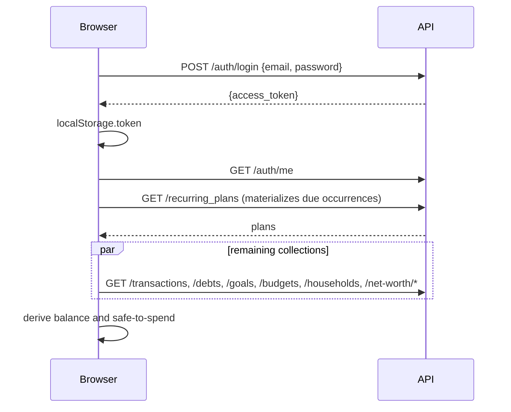

# BuFin: Low-Level Design

Describes `main` as of November 2026. Pair with `HLD.md`.

## 1. Backend

### 1.1 Request lifecycle
`main.py` creates the FastAPI app, adds `CORSMiddleware`, mounts ten routers under `/api`, and calls `Base.metadata.create_all()` at import (Alembic remains the source of truth for schema changes).

Dependencies injected into handlers:

| Dependency | File | Does |
|---|---|---|
| `get_db` | `database.py` | Yields a `SessionLocal()`; closes in `finally`. |
| `get_current_user` | `routers/auth.py` | Decodes the bearer JWT (`sub` = email), loads the `User`, else 401. Declared `async def` but uses a synchronous session. |
| `get_active_household_id` | `routers/auth.py` | Reads `X-Household-Id`. No header gives `None` (personal). Header present but caller not a member gives 403. |

### 1.2 Endpoints (57)

| Router | Prefix | Methods | Notes |
|---|---|---|---|
| auth | `/api/auth` | signup, login, me (get/put/delete), change-password | Deleting an account blocks if the caller is the sole owner of a household with other members. |
| transactions | `/api` | list, create, update, delete | Scoped by `_scope_filter`; `household_id` is always server-set. |
| recurring | `/api/recurring_plans` | list, create, update, delete | List triggers lazy materialization. |
| debts | `/api/debts` | list, create, update, delete | |
| budgets | `/api/budgets` | list, create, update, delete | |
| goals | `/api/goals`, `/api/wishlist` | goals list, create, update, delete; wishlist list, create, delete | PUT on a goal diffs `currentAmount` into a signed `GoalContribution`. |
| households | `/api/households` | create, list, invites, join, members, role, remove, leave, delete | Multiple owners allowed; sole-owner guards. |
| net_worth | `/api/net-worth` | assets and liabilities CRUD, snapshots | Snapshot written on every mutation. |
| chat | `/api/chat/sessions` | list, get, create, add message, delete | Hard delete; ownership checked in `_get_owned_session`. |
| ai | `/api/ai/*`, `/api/coach/chat` | classify, analyze, alert, tips, coach chat | Calls `ai_service`. |

### 1.3 Data model

All primary keys are `String` UUIDs. All owned rows carry `user_id`. Dates are ISO `String`. Money is `Float`.

| Table | Columns (beyond `id`, `user_id`) | Constraints and indexes |
|---|---|---|
| users | email, hashed_password, full_name, currency, monthly_income, current_balance, savings_goal, financial_literacy, risk_tolerance, goals(JSON string) | unique+index on email |
| transactions | date, amount, category, description, merchant, type, necessity, remarks, linked_debt_id, household_id, recurring_plan_id | FKs to debts, households, recurring_plans. **No index on user_id, date or household_id.** |
| recurring_plans | name, amount, type, frequency, expectedDate, endDate | `expectedDate` is a string: "1".."31", "last", "last-working" |
| debts | personName, amount, direction, dueDate, status | |
| wishlist | name, cost, addedAt | |
| goals | name, targetAmount, currentAmount, targetDate, icon, fundingSource, type, projectedReturnRate, household_id | |
| goal_contributions | goal_id, amount(signed), created_at | |
| budgets | category, monthlyLimit | |
| households | name, created_by, created_at | |
| household_members | household_id, role, joined_at | |
| household_invites | household_id, code(unique, index), created_by, expires_at, used_by | |
| assets / liabilities | name, category, current_value / current_balance, created_at | |
| net_worth_snapshots | total_assets, total_liabilities, recorded_at | |
| chat_sessions / chat_messages | mode, title, created_at, updated_at / session_id, role, content | |

Type and status columns are free strings with no `CHECK` constraint.

### 1.4 Key algorithms

**Household scope filter** (`transactions.py`, `goals.py`):
```
if household_id: rows where household_id == household_id
else:            rows where user_id == me AND household_id IS NULL
```
A view is one or the other, never both.

**Recurring materialization** (`recurring.py`, runs on every `GET /recurring_plans`):
```
for each monthly plan of the user:
    anchor = month after the latest transaction tagged with plan.id
             else the current month               # no created_at to backfill from
    for each month from anchor to current month:
        day = resolve_expected_day(plan.expectedDate, year, month)  # clamps 31 -> last day
        stop if past plan.endDate
        if month is current and day > today: stop
        insert Transaction(recurring_plan_id = plan.id)
```
Idempotent because the anchor always moves forward from the last tagged row. Known gap: plans that predate the feature are not backfilled (issue #74). The same day-resolution rule exists in JavaScript (`resolveExpectedDay`) and is duplicated, with one behavioural difference (issue #75).

**AI routing** (`ai_service.py`):
- `_try_ollama` returns `None` when Ollama is disabled, skipped, or fails; a failure opens a 5-minute skip window (`_ollama_unavailable_until`, a process-local module global).
- `classify_transaction`: try Ollama, parse JSON, run `_amounts_plausible` (single-action responses must contain an amount literally present in the input, "k" expanded); on any failure call Gemini and check again.
- Prompt: one large string (`DATA_ANALYST_PROMPT`) with four action shapes (`transaction`, `debt`, `recurring`, `update_recurring`) and few-shot examples.
- `coach_chat` bypasses the SDK with a manual REST call to get `google_search` grounding.

**Goal contribution diff** (`goals.py`): the client sends the new total; the server computes `delta = new - old` and stores a signed contribution tagged to the caller.

### 1.5 Migrations
Alembic, linear chain, single head expected. Two earlier collisions came from parallel branches with the same `down_revision`. Baseline migration assumes tables already exist (created by `create_all`), so `alembic upgrade head` does not work on an empty database.

### 1.6 Error handling
Handlers raise `HTTPException`. There is no global exception layer other than one handler mapping Gemini quota errors to 429. No structured logging or request ids.

## 2. Frontend

### 2.1 Structure
```
src/
  main.jsx            ThemeProvider (key "bufin-theme") > AuthProvider > Router
  App.jsx             routes, ProtectedRoute, AppLayout (Navigation + main)
  context/            Auth, Financial, Theme, Toast
  lib/                api.js (every request), money.js, utils.js (cn, resolveExpectedDay,
                      todayLocalStr), chartTheme.js
  hooks/              useSafeToSpend, useSpendingAlert
  pages/              Dashboard, Ledger, Planner, Goals, Budgets, Households, NetWorth,
                      Insights, Coach, Profile, Login, Signup, Onboarding
  components/         feature components; ui/ holds primitives (button, card, dialog, ...)
```

### 2.2 State
`FinancialContext` is the single source of truth. On mount it fetches 10 collections (recurring plans first, because that call materializes transactions that the transactions fetch must then include). It exposes the collections plus mutation functions that call `api.js` and update local state, and it derives `balance`, `income`, `expense`, `totalAssets`, `netWorth`, and similar.

Persona switch: `activeHouseholdId` is stored in `localStorage` (`bufin_active_household`); `api.js` reads it to add `X-Household-Id` to transaction and goal calls, and `switchPersona` re-fetches those two collections.

### 2.3 Safe-to-spend (`useSafeToSpend`)
Derived entirely in the browser from `balance`, recurring plans, debts and transactions: upcoming recurring expenses and income, payable debts, a conservative safe balance, a per-day limit over the remaining days, today's spend, and a usage percentage. Because it depends on the full transaction list it cannot move server-side without an aggregate endpoint (see roadmap P1).

### 2.4 Styling
Tailwind 4 with CSS variables in `src/index.css` (light and dark token sets, one data hue `--data`). `chartTheme.js` maps Recharts to those variables. Privacy Mode is a context flag that components must check before printing a figure.

### 2.5 Known frontend gaps
Single 1 MB JavaScript bundle, no route-level code splitting; no tests; no TypeScript; server state and UI state live in one context; every page re-renders on any collection change.

## 3. Sequence: login and first load



## 4. Conventions to keep
- Every new owned table gets `user_id`, an index on it, and an ownership check in every handler (404, not 403, for other users' ids).
- Household-shareable tables follow the `household_id` nullable pattern and `_scope_filter`.
- Schema changes go through Alembic; check `alembic heads` returns one head before merging.
- Money formatting goes through `lib/money.js`; every displayed figure respects Privacy Mode.
- Dates compared as local calendar days use `todayLocalStr` or the date part of the ISO string, never a raw datetime against a date.
